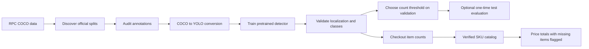

<div align="center">

# Retail Product Checkout Vision

### Fine-grained product detection, checkout counting, and price verification

[](https://www.python.org/)
[](https://jupyter.org/)
[](https://docs.ultralytics.com/tasks/detect/)
[](https://rpc-dataset.github.io/)

**A reproducible computer-vision study for recognizing retail products in checkout scenes.**

[Quick start](#-quick-start) · [Pipeline](#-pipeline) · [Evaluation](#-evaluation) · [Limitations](#-limitations) · [References](#-references)

</div>

---

## Overview

This project fine-tunes a pretrained YOLO detector on the [Retail Product Checkout (RPC) dataset](https://rpc-dataset.github.io/). It audits the COCO annotations, converts the official data splits into YOLO format, trains and evaluates a detector, measures checkout item-count quality, and provides a safe integration point for a real store catalog.

The notebook is designed to be run on Kaggle with a GPU. It **does not include the dataset, model weights, or fabricated product prices**. Its default `full` profile uses all 53,739 official training images and all 6,000 validation images. A `quick` profile is available for pipeline checks; results from that smaller subset are exploratory.

> **Research caveat:** RPC training images contain one product in a controlled setting, while validation and test images show cluttered checkout scenes. This domain gap makes the task difficult; more epochs alone do not guarantee better checkout performance. The RPC project reports an average of 12.27 objects per validation image. See the [dataset card](DATASET_AND_LICENSE.md) and [methodology](METHODOLOGY.md).

## Highlights

- Preserves the official train, validation, and test boundaries.
- Resolves Kaggle dataset mounts without recursively indexing every image when a known path is available.
- Audits category IDs, image references, dimensions, and bounding boxes before conversion.
- Generates YOLO labels with a consistent class map and verifies the converted labels.
- Supports full and quick training profiles, reproducible seeds, automatic batch sizing, and early stopping.
- Reports precision, recall, mAP@0.50, mAP@0.50:0.95, per-class mAP, exact checkout-count accuracy, and mean absolute count error.
- Selects the checkout confidence threshold on validation and keeps the official test split opt-in.
- Refuses to present a complete bill unless a verified SKU-level catalog supplies the product identity and price.
- Keeps console output concise and stores detailed training history under the Kaggle working directory.

## Pipeline



## Quick start

### 1. Open the notebook

Open [`retail-product-checkout-vision.ipynb`](retail-product-checkout-vision.ipynb) in Kaggle or Jupyter. On Kaggle, attach the **Retail Product Checkout Dataset** input and enable a GPU accelerator.

The notebook looks for the known Kaggle mount first and falls back to KaggleHub when needed. Kaggle may require you to accept the dataset's terms before it can be downloaded.

### 2. Select a run profile

In the configuration cell:

```python
TRAINING_PROFILE = "full"
```

| Profile | Train images | Validation images | Epochs | Purpose |
|---|---:|---:|---:|---|
| `full` (default) | All 53,739 | All 6,000 | 50 | Full experiment; can take several hours depending on the Kaggle GPU |
| `quick` | 2,000 | 1,000 | 20 | Check data paths, conversion, and end-to-end execution |

The quick profile is **not** a substitute for full-split results. Both profiles sample only within their own official split. The 24,000-image test split is not loaded unless `PREPARE_OFFICIAL_TEST = True` is enabled after model selection.

### 3. Run from top to bottom

The notebook saves the converted dataset and training artifacts under:

```text
/kaggle/working/retail_price_verification/
```

The epoch history is saved in `runs/rpc_yolo26n_baseline/results.csv`; the selected checkpoint is saved as `runs/rpc_yolo26n_baseline/weights/best.pt`. Kaggle working storage is temporary, so download artifacts you need before the session ends.

### Local environment

Python 3.10 or newer is recommended. Install the packages with:

```bash
python -m pip install -r requirements.txt
```

Then open the notebook in Jupyter and attach the RPC dataset through KaggleHub or a local dataset mount.

## Evaluation

The notebook reports standard detector metrics and checkout-specific count metrics separately:

| Metric | What it measures |
|---|---|
| Precision / recall | Detection quality at the configured operating point |
| mAP@0.50 | Detection average precision at IoU 0.50 |
| mAP@0.50:0.95 | COCO-style average over IoU thresholds |
| Per-class mAP | Class-level performance and weak categories |
| Exact checkout-count accuracy | Share of images with every class count exactly correct |
| Mean absolute item-count error | Average absolute object-count error per image |

The confidence threshold is selected on validation and frozen before optional test evaluation. For official RPC benchmark metrics, export predictions and follow the authors' [`rpctool`](https://github.com/WeiGaoming/RPC-tool) evaluation protocol. This repository does not claim benchmark results because a complete, validated full run has not yet been published.

## Price verification

The detector's class label is not automatically a store SKU. To estimate a bill, populate `SKU_PRICE_CATALOG` in the notebook with verified product identifiers, names, and current prices. The notebook marks missing catalog entries as unpriced instead of silently inventing a total. This is a research demo, not a production point-of-sale system.

## Limitations

- **Domain gap:** single-product training photos differ from the crowded checkout validation/test scenes.
- **Fine-grained classes:** visually similar packaging, occlusion, glare, rotation, and product redesigns can cause false detections or missed products.
- **Price data:** RPC does not provide a current store-specific price catalog; checkout totals require an external, verified SKU mapping.
- **Runtime:** the full split and 50 epochs can take hours on shared Kaggle GPUs. Check the selected accelerator and available session limits before starting.
- **Unseen products:** this closed-set detector cannot reliably identify products absent from its training categories.

## Repository layout

```text
.
├── DATASET_AND_LICENSE.md
├── METHODOLOGY.md
├── MODEL_CARD.md
├── .gitignore
├── CITATION.cff
├── CONTRIBUTING.md
├── README.md
├── retail-product-checkout-vision.ipynb
└── requirements.txt
```

## References

1. Wei et al., [RPC: A Large-Scale and Fine-Grained Retail Product Checkout Dataset](https://rpc-dataset.github.io/).
2. [Solving automatic check-out with fine-tuned YOLO models](https://doi.org/10.1016/j.procs.2024.09.644), *Procedia Computer Science*, 2024.
3. Kuzucu et al., [On Calibration of Object Detectors: Pitfalls, Evaluation and Baselines](https://arxiv.org/abs/2405.20459), ECCV 2024.
4. Lamm and Keuper, [A Visual RAG Pipeline for Few-Shot Fine-Grained Product Classification](https://openaccess.thecvf.com/content/CVPR2025W/FGVC/html/Lamm_A_Visual_RAG_Pipeline_for_Few-Shot_Fine-Grained_Product_Classification_CVPRW_2025_paper.html), CVPR Workshops 2025.
5. [Ultralytics object detection](https://docs.ultralytics.com/tasks/detect/) and [validation](https://docs.ultralytics.com/modes/val/) guides.

## License and dataset use

The RPC dataset is distributed under **CC BY-NC-SA 4.0** and is listed by its authors as available for academic use; contact the authors for other purposes. Dataset images and annotations are not included in this repository. See [`DATASET_AND_LICENSE.md`](DATASET_AND_LICENSE.md) before downloading or using the data. Ultralytics and pretrained weights have their own licensing terms; review them separately, especially before commercial use.

---

<div align="center">

Built as a reproducible learning project. Contributions that improve evaluation rigor, runtime, or checkout-scene generalization are welcome.

</div>
